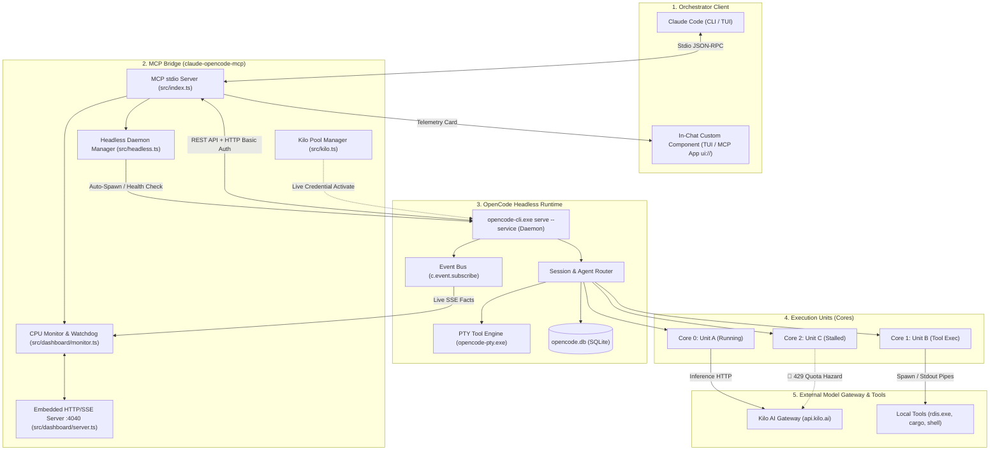

# claude-opencode-mcp

A **stdio MCP server** that lets a Claude orchestrator (Claude Code / build orchestrator) control a local **OpenCode V2** desktop instance.

It exposes 21 MCP tools for session/agent management, Kilo multi-account control, task delegation, and fact-based CPU architecture telemetry — all running against the local OpenCode service via the official [`@opencode/client`](https://www.npmjs.com/package/@opencode/client).

## Connect Claude to this bridge

Run the following in your terminal to register the server with Claude Code:

```cmd
claude mcp add opencode-bridge -- bun run <path-to-repo>/src/index.ts
```

Claude will then expose all `oc_*` and `kilo_*` tools to the orchestrator.

## System Architecture



## Architecture Hazards & Bottleneck Analysis

Where stalls, latency spikes, and deadlocks occur across this pipeline:

```text
  [ Claude Code ]
         │ (Hazard 7: Stdio payload serialization)
         ▼
  [ MCP Bridge ] ──(Hazard 3: Stale service.json / zombie PID)──► [ opencode-cli daemon ]
         │                                                               │
         ├─(Hazard 2: In-memory credential cache desync)                 ▼
         │                                                      [ Execution Cores ]
         │                                                               │
         │                    ┌──────────────────────────────────────────┴─────────────────────────┐
         ▼                    ▼                                                                    ▼
 [ Kilo Pool ] ◄──(Hazard 1: Shared 429 bottleneck)── [ Model Gateway ]                 [ Local Tool Engine ]
                                                                                                   │
                                                         (Hazard 4: Command hang / unquoted CLI)───┘
                                                         (Hazard 5: Headless prompt trap)──────────┘
                                                         (Hazard 6: Compaction pause)──────────────┘
```

### 1. Hazard 1: Shared Key Quota Funnel (Single-Point Rate Limit)
- **Root Cause**: Cores (sessions) execute in parallel, but they all share the **single active Kilo provider credential** in OpenCode.
- **Symptom**: If Core 0 exhausts its free tier quota (429 Rate Limit), requests from Cores 1, 2, and 3 fail simultaneously.
- **Factual Evidence**: Event `session.execution.failed` or `error.status: 429` with payload `"Free model usage limit reached"`.
- **Mitigation**: The bridge's key pool (`kilo_rotate`) tracks per-key cooldowns with exponential backoff (5, 10, 20, 40m) and moves to the next usable key.

### 2. Hazard 2: In-Memory Credential Store Cache Desync
- **Root Cause**: OpenCode maintains its own in-memory credential cache. Simply updating `auth.json` on disk does not immediately re-arm in-flight requests.
- **Symptom**: Stale keys continue being hammered for 15-20 seconds after a disk update.
- **Mitigation**: `activateInOpenCode()` calls the live RPC method `client.credential.activate({ key })` to force in-memory eviction and instant live uptake.

### 3. Hazard 3: Stale Discovery Lock & Zombie Contender
- **Root Cause**: The `@opencode/client` discovers local daemons via `~/.local/state/opencode/service.json`. If a previous daemon crashes or reboots unexpectedly, the file remains with a dead PID.
- **Symptom**: `Service.ensure()` attempts connection, waits for 3 successive timeouts (up to 12s), and evicts the stale registration before spawning a new contender.
- **Mitigation**: `ensureHeadlessService()` in `src/headless.ts` performs proactive PID liveness testing (`process.kill(pid, 0)`) and HTTP health probes, spawning `opencode serve --service` directly if unreachable.

### 4. Hazard 4: Tool Execution Hang (Interactive CLI Deadlock)
- **Root Cause**: Shell tools run synchronously within the session turn. If a command (e.g., PowerShell invoking `rdis.exe` without quotes, or a tool waiting for `[y/N]` interactive input) blocks, the tool runner hangs.
- **Symptom**: Zero token output, session stuck in `TOOL_EXEC` for 30s-120s until tool timeout.
- **Mitigation**: The bridge watchdog monitors `elapsedMs` on running tools; if $>35$s elapses without response, it triggers a `TOOL_HANG` hazard banner and allows immediate one-click core interruption via `oc_interrupt_session`.

### 5. Hazard 5: Headless Interactive Question / Permission Trap
- **Root Cause**: Agents may prompt for confirmation or question clarifications (`form.created` or `permission.asked`). In headless mode with no desktop UI open, nobody is there to answer.
- **Symptom**: The session silently idles indefinitely.
- **Mitigation**: The event monitor captures `form.created` and flags `QUESTION_WAIT`, alerting the orchestrator or auto-rejecting to force conservative execution.

### 6. Hazard 6: Context Compaction Latency Spike
- **Root Cause**: High-token sessions hit context bounds, triggering `session.compaction.started`. OpenCode performs an LLM summarization step.
- **Symptom**: The core produces 0 output tokens for 15-45 seconds, resembling a freeze.
- **Mitigation**: The factual event stream explicitly monitors `session.compaction.started` / `ended` to differentiate harmless compaction from a dead stall.

### 7. Hazard 7: Stdio Transport Serialization
- **Root Cause**: Claude Code talks to the MCP bridge via stdin/stdout JSON-RPC. Synchronous blocking operations or dumping megabytes of raw JSON logs blocks the orchestrator's event loop.
- **Mitigation**: All logging is routed to `stderr` or the embedded SSE server (`:4040`); tool outputs return structured summaries and TUI components without megabyte JSON dumps.

## Prerequisites

- **Bun** installed (`bun --version` → 1.3.14+)
- **OpenCode V2** installed (desktop app or CLI; the bridge automatically starts the background daemon headlessly if not running)
- Dependencies installed: `bun install`

## Project layout

```
claude-opencode-mcp/
├── src/
│   ├── index.ts              # MCP stdio server + 21 tool registrations & UI resource
│   ├── openCode.ts           # OpenCode client adapter (headless auto-start)
│   ├── headless.ts           # Headless daemon lifecycle manager
│   ├── kilo.ts               # Kilo multi-account state management
│   ├── tasks.ts              # File-backed task registry (tasks.json)
│   ├── config.ts             # Paths, secret masking, workspace allowlist, model parsing
│   └── dashboard/
│       ├── monitor.ts        # CPU core monitor & stall hazard watchdog
│       ├── render.ts         # Message formatter (JSON → application-grade output)
│       ├── tui.ts            # Terminal UI component renderer (in-chat dashboard)
│       ├── server.ts         # Embedded HTTP/SSE dashboard server (:4040)
│       └── ui.html           # Interactive HTML dashboard & inspector
├── scripts/
│   ├── supervisor/           # Multi-unit supervisor, keeper loop, and key rotations
│   └── probes/               # Diagnostic probes, SSE event dumpers, test scripts
├── package.json              # deps: @modelcontextprotocol/sdk, @opencode/client, zod
├── tsconfig.json             # strict TypeScript, scoped to src/**/*
├── bun.lock
└── README.md
```

## MCP tools

### Session management
| Tool | Purpose |
|------|---------|
| `oc_create_session` | Create a session (directory, optional title/agent/model) |
| `oc_list_sessions` | List sessions |
| `oc_get_session` | Get a session + recent messages |
| `oc_switch_model` | Switch a session's model |
| `oc_switch_agent` | Switch a session's agent |
| `oc_interrupt_session` | Interrupt a session |
| `oc_delete_session` | Delete a session |

### Agent / subagent management
| Tool | Purpose |
|------|---------|
| `oc_create_agent` | Write `.opencode/agents/<name>.md` with frontmatter `{name, model, permission, instructions}` |
| `oc_create_subagent` | Create a child session (parentID), bind agent, send initial prompt |
| `oc_list_agents` | Combined file-based (`.opencode/agents`) + API agent list |

### Kilo multi-account (direct plugin-state file management)
| Tool | Purpose |
|------|---------|
| `kilo_status` | Active account, cooldowns, **masked** secrets |
| `kilo_list_accounts` | Same as status as raw JSON (secrets masked) |
| `kilo_switch_account` | Set active account, clear cooldown, sync `auth.json` |
| `kilo_add_account` | Append an API-key account, sync `auth.json` |
| `kilo_clear_cooldown` | Clear cooldown for one account or all |

### Orchestration & CPU Architecture Monitoring
| Tool | Purpose |
|------|---------|
| `oc_delegate_task` | Create session, bind agent/model, send instructions, register task |
| `oc_task_status` | Read task registry + session outcome, return status/events/result |
| `oc_open_dashboard` | Open the real-time CPU Status & Telemetry Dashboard GUI (`http://localhost:4040`) in browser |
| `oc_cpu_status` | Get factual telemetry on execution cores, IPC token throughput, and stall hazards |
| `oc_service_status` | Check or proactively ensure headless background OpenCode service (PID, URL, version) |
| `oc_get_session_rendered` | Get application-grade rendered OpenCode session output (thoughts, tool runs, text, errors) |

## Headless Mode (No Desktop App Needed)

The bridge automatically operates completely headlessly:
- It discovers and binds `opencode-cli.exe` without requiring OpenCode's Electron desktop app to be open.
- If the background service is stopped, `ensureHeadlessService()` automatically launches `opencode-cli.exe serve --service` detached in the background.
- An `opencode.cmd` wrapper can be installed to `~/.bun/bin` (or on PATH) so `opencode` is universally available in the terminal.

## CPU Status GUI & Real-Time Dashboard

The bridge features an embedded, real-time CPU Architecture Dashboard served at `http://localhost:4040`:
- **CPU Execution Pipeline:** Views OpenCode sessions as parallel execution cores (Core 0, Core 1...) with pipeline stages (`EXECUTING`, `TOOL_EXEC`, `STALLED`, `RETIRED`, `FAULT`, `IDLE`).
- **Factual Telemetry & Hazard Engine:** Accurately detects stalls based on real-time facts:
  - 429 Quota Exhaustion hazards with live backoff cooldown timers.
  - Zero-Progress stalls (running core with 0 token deltas for > 50s).
  - Tool execution hangs (shell commands running > 35s).
  - Form and permission blocks.
- **Rendered OpenCode App View:** Clicking any core displays the real OpenCode rendered stream (collapsible thinking blocks, dark terminal tool executions with stdout/stderr and exit codes, Markdown typography, and errors) without raw JSON clutter.
- **Server-Sent Events (SSE):** Direct real-time streaming of OpenCode event bus facts to the GUI.

## Kilo plugin activation

As part of setup, the Kilo multi-account plugin can be added to the OpenCode global config plugin array:

`~/.opencode/opencode.jsonc`
```jsonc
"plugin": [
    "@tarquinen/opencode-dcp@3.1.3",
    "@franlol/opencode-md-table-formatter@0.0.6",
    "@file:./plugins/kilo-multi-account"
]
```

This loads `./plugins/kilo-multi-account.ts` so its fetch interceptor auto-rotates accounts on rate limits. The MCP `kilo_*` tools provide manual override (switch/add/clear-cooldown).

## Security & redaction

- **Secrets are never returned raw.** API keys are masked (`sk-t...cdef` — first 4 + last 4 chars).
- **Auth headers/passwords are redacted** in any error output.
- **Directories and paths are masked** to prevent leaking local usernames or system file paths.
- **Workspace allowlist:** by default all directories are allowed. Set `OCMCP_ALLOWED_DIRECTORIES` (comma-separated) to restrict session creation to approved directories.
- The bridge writes active Kilo credentials to `~/.local/share/opencode/auth.json` under the `"kilo"` key (same location the Kilo plugin uses).

## Environment variables

| Variable | Purpose | Default |
|----------|---------|---------|
| `OCMCP_ALLOWED_DIRECTORIES` | Comma-separated allowed session directories | (unset = allow all) |
| `OCMCP_AGENTS_DIR` | Override `.opencode/agents` dir | `~/.opencode/agents` |
| `OCMCP_TASKS_REGISTRY` | Override `tasks.json` location | `<cwd>/tasks.json` |
| `OCMCP_KILO_*`, `OCMCP_AUTH_JSON_PATH` | Override Kilo/auth paths | standard OpenCode locations |

## Development

```bash
# Type-check
bun run typecheck

# Start the stdio server (used by claude mcp add)
bun start
```

## Verification performed

- `bun run typecheck` passes (strict TypeScript, 0 errors)
- Server starts and responds to MCP `initialize`
- `tools/list` returns all 21 tools with valid JSON Schemas
- `ui://opencode/cpu-dashboard` registered for native Claude Code component rendering
- Headless auto-spawning verified via `opencode-cli.exe serve --service`
- `oc_list_sessions` returns live OpenCode sessions
- `kilo_status` / `kilo_list_accounts` read state files (secrets masked)
- `kilo_add_account` → writes `accounts.json` + `state.json` + `auth.json`
- `oc_create_agent` → writes `.opencode/agents/<name>.md` with frontmatter
- `oc_delegate_task` → creates session + task; `oc_task_status` reports status
- Embedded dashboard server verified on port 4040 with SSE stream
